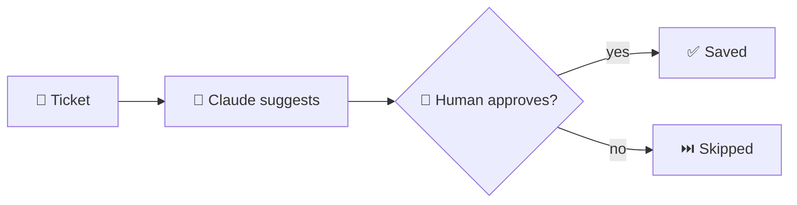

# 🤖 ai-it-automation

Small learning projects that use the Claude API for everyday IT support work.

The main idea: **the AI suggests, a human approves.** Nothing is sent to a customer automatically.



## What is inside

| File | What it does |
|---|---|
| `ticket_summarizer.py` | Summarizes each open ticket in one sentence and suggests a priority |
| `ticket_triage.py` | Suggests a category and a first reply. You approve or skip each one |
| `claude_client.py` | Small helper that sends a request to the Claude API (standard library only) |
| `prompts/it-prompts.md` | Reusable prompts for troubleshooting, documentation, and customer replies |
| `tickets.json` | Fake sample tickets (`customer-A`, `customer-B`, ...) |

## Try it without an API key (dry run)

Dry run sends **nothing**. It shows the request that would be sent and uses a made-up answer, so you can test the whole flow for free.

```bash
python3 ticket_summarizer.py --dry-run
python3 ticket_triage.py --dry-run
```

If no API key is set, the scripts switch to dry run automatically.

## Use the real Claude API

1. Create an API key in the Claude Console.
2. Save it as an environment variable. **Never put it in a file or on GitHub.**

   Linux / Mac:
   ```bash
   export ANTHROPIC_API_KEY="your-key-here"
   ```
   Windows (PowerShell):
   ```powershell
   $env:ANTHROPIC_API_KEY="your-key-here"
   ```
3. Run the scripts without `--dry-run`:
   ```bash
   python3 ticket_summarizer.py
   python3 ticket_triage.py
   ```

To use a different model, set `CLAUDE_MODEL` the same way.

## Safety rules

- Only fake or anonymized data in this repo. No real customer data, passwords, or internal IPs.
- Real customer data only after the company has approved the tool, and after checking GDPR and where the data goes.
- A human approves before anything is sent or saved.

   ## Status
   Tested in dry-run mode. Next steps: tool use, MCP, and n8n.
